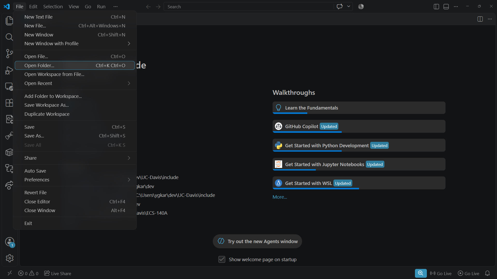
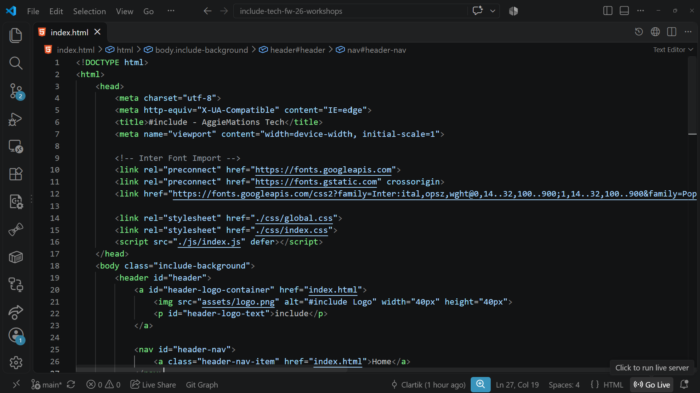
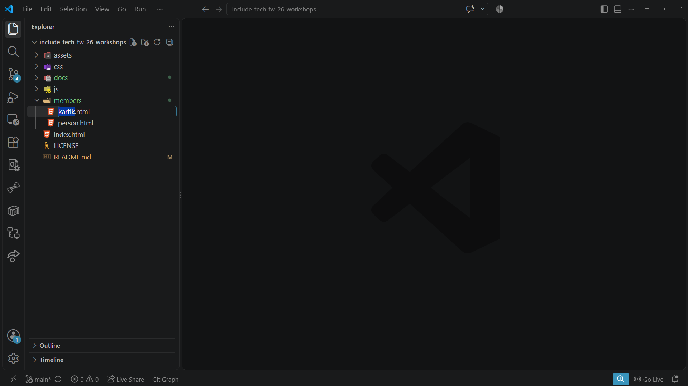

# include-tech-fw-26-workshops

The workshops for the F/W 26-27 Tech Cohort of **#include** (AggieMations Tech Team) at UC Davis.

This repo is a static website (plain HTML, CSS, and JavaScript). The homepage lists every member of the tech team and each member card links to that member's About Me page.

## Getting Started

1. Clone the repo:
   ```bash
   git clone https://github.com/Clartik/include-tech-fw-26-workshops.git
   cd include-tech-fw-26-workshops
   ```

2. Open VS Code with the Repo Folder:
   

   OR
   ```bash
   cd include-tech-fw-26-workshops
   code .
   ```
3. Open **index.html** and Launch **Go Live**
   

## Project Structure

```
.
├── index.html                  # Homepage with member cards
├── members/
│   └── TEMPLATE.html           # Member About Me page (Template)
├── css/
│   ├── global.css              # Styles shared across pages
│   ├── index.css               # Homepage styles
│   └── members/
│       └── TEMPLATE.css        # Member page styles (Template)
├── js/
│   ├── index.js                # Homepage scripts
│   └── members/
│       └── TEMPLATE.js         # Member page scripts (Template)
├── assets/
│   ├── logo.png                # #include logo
│   ├── person.png              # Placeholder member photo
│   └── members/
│       └── TEMPLATE/
│           └── warning.png     # Image used by the template
├── docs/                       # Ignore folder, this is used for README.md
├── .gitignore
├── LICENSE
└── README.md
```

## Contributing

1. Create a branch off `main` (`git checkout -b [name]-dev`).
2. Duplicate `./members/TEMPLATE.html` and rename it to `[name].html`
   
3. Duplicate the template's matching files and rename them to `[name]`, so each page has its own:
   - `./css/members/TEMPLATE.css` → `./css/members/[name].css`
   - `./js/members/TEMPLATE.js` → `./js/members/[name].js`
   - `./assets/members/TEMPLATE/` → `./assets/members/[name]/` (put your images here)
4. Update the paths in your `[name].html` to point to your new files.
5. Start here/paste your About Me page code.

## License

See [LICENSE](LICENSE).
